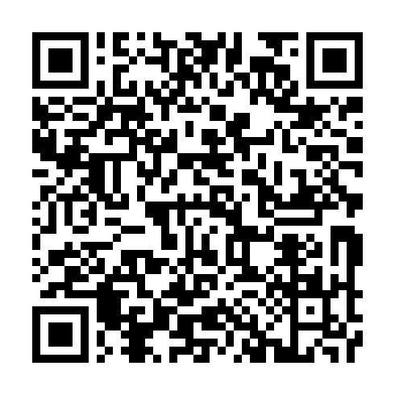

# Tracking links

One link per channel. Each team member posts **only their own channel's link**, so every visit and sign-up can be traced to a channel. The page reads `utm_source`, `utm_medium` and `utm_campaign` and stores them with each form submission; it also fires a `landing-<utm_source>` event in GoatCounter.

| Channel | Link | Owner |
|---|---|---|
| linkedin | https://dansl5.github.io/EDHEC_sourcelens/?utm_source=linkedin&utm_medium=social&utm_campaign=hw2 | {{TODO: experiment owner / dates}} |
| whatsapp | https://dansl5.github.io/EDHEC_sourcelens/?utm_source=whatsapp&utm_medium=social&utm_campaign=hw2 | {{TODO: experiment owner / dates}} |
| instagram | https://dansl5.github.io/EDHEC_sourcelens/?utm_source=instagram&utm_medium=social&utm_campaign=hw2 | {{TODO: experiment owner / dates}} |
| edhec-cohort | https://dansl5.github.io/EDHEC_sourcelens/?utm_source=edhec-cohort&utm_medium=community&utm_campaign=hw2 | {{TODO: experiment owner / dates}} |
| newsroom-outreach | https://dansl5.github.io/EDHEC_sourcelens/?utm_source=newsroom-outreach&utm_medium=email&utm_campaign=hw2#newsrooms | {{TODO: experiment owner / dates}} |
| qr-hallway | https://dansl5.github.io/EDHEC_sourcelens/?utm_source=qr-hallway&utm_medium=print&utm_campaign=hw2 | {{TODO: experiment owner / dates}} |

## QR code for hallway tests

File: `experiment/qr-hallway.png`, generated by `experiment/make_qr.py` (standard library only, no online service). It decodes to the qr-hallway link above (checked with Chrome's `BarcodeDetector`). Regenerate with `python3 experiment/make_qr.py`.

## Keep team visits out of the data

Before opening the page yourself, run this once per browser in the developer console. GoatCounter then skips your visits:

`localStorage.setItem('skipgc', 't')`

Test submissions are removed by `analyze.py` (email contains "test", `utm_source=test`, or listed in `experiment/exclude.txt`).
